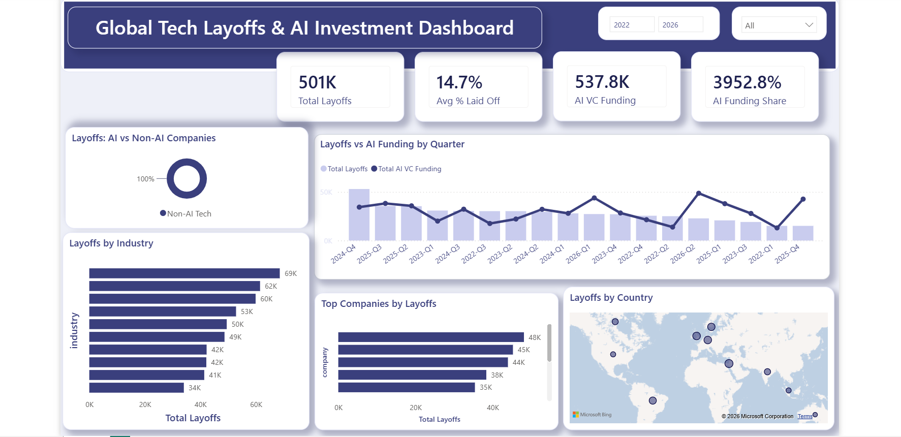

# 📊 Global Tech Layoffs vs. AI Investment Dashboard

An executive-level Power BI analytics dashboard built to examine global tech workforce reductions alongside venture capital funding trends in the AI sector.

---

## 📸 Dashboard Overview

> **Note:** To explore the interactive visual calculations and DAX measures directly, download the raw [Power BI (.pbix) File](dashboards/Global_Tech_Layoffs_vs_AI_Boom.pbix) or open the [PDF Summary Report](dashboards/Global_Tech_Layoffs_vs_AI_Boom.pdf).

---

## 🔑 Key Features & Design Architecture
* **Executive KPI Cards:** Top-level metrics displaying Total Layoffs (`501K`), Avg % Laid Off (`14.7%`), Total AI VC Funding (`537.8K`), and AI Funding Share (`3952.8%`).
* **Capital Reallocation Trend:** Dual-axis quarter-over-quarter chart tracking workforce reductions against capital flowing into AI ventures.
* **Geographical & Sector Breakdown:** Spatial map distribution alongside industry and company-level layoff rankings.
* **Modern UI/UX Design:** Standardized 3-tier container layout built with high-contrast slate themes (`#EBF0F7`), deep navy highlights, and 12px rounded card containers.
